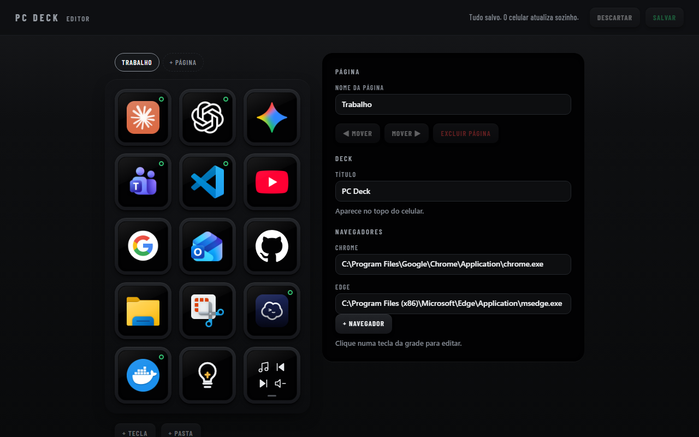

# PC Deck

Um Stream Deck caseiro: o celular vira um painel de atalhos do PC Windows, com teclas LCD e monitor de CPU, RAM e GPU em tempo real.

- **Agente no PC:** Node puro, sem `npm install`. Executa só as ações cadastradas em `deck.json`.
- **Painel no celular:** PWA em tela cheia, com acesso privado via Tailscale (HTTPS) e pareamento por QR code.
- **Editor visual no PC:** monte as teclas arrastando, com lista dos apps instalados e ícones automáticos.

O que as teclas fazem:

- **Abrir** apps, programas e sites.
- **Teclas vivas:** LED de app aberto e capa da música tocando.
- **Pastas** de teclas.
- **Capturar ideia por voz:** o texto vai para uma nota no PC (Obsidian ou `.md`).
- **Atalhos de teclado:** combinações, mídia e volume.
- **Rotinas:** uma tecla roda vários passos ("Começar o dia" abre Outlook, Teams e Claude).
- **Sistema:** bloquear a tela e suspender o PC.

Instalação e uso: [pc-deck/README.md](pc-deck/README.md).

## Estrutura

| Caminho | O que é |
|---|---|
| `pc-deck/server.js` | Agente local: API, monitor, teclas vivas e execução das ações |
| `pc-deck/deck.json` | Teclas, com ícone e ação de cada uma |
| `pc-deck/public/` | O app do celular (PWA) e o editor (`editor.html`) |
| `pc-deck/tools/` | Script que tira o ícone de um app do Windows |
| `PRODUCT.md`, `DESIGN.md` | Contexto do produto e design system |

## Licença

Código sob a [licença MIT](LICENSE) (detalhes de terceiros em [NOTICE](NOTICE)): pode usar, copiar, modificar e redistribuir à vontade, inclusive em projeto comercial, desde que mantenha o aviso de copyright. Vem sem garantia.

O que é de terceiros segue a licença original:

| Material | Licença |
|---|---|
| Fonte Barlow Condensed (`pc-deck/public/fonts/`) | SIL Open Font License 1.1 ([OFL.txt](pc-deck/public/fonts/OFL.txt)) |
| qrcodejs (`pc-deck/public/vendor/`) | MIT, (c) 2012 davidshimjs |
| Ícones de apps e sites (`pc-deck/public/icons/`) | Marcas dos respectivos donos, **fora da MIT**. Estão aqui só para identificar cada atalho; troque-os se for redistribuir o projeto. |

Projeto pessoal, sem vínculo com Elgato, Anthropic, OpenAI, Google, Microsoft, GitHub, Docker ou Termius.
