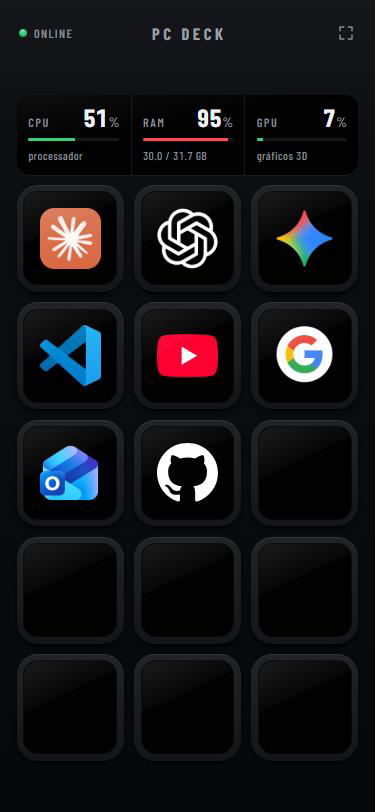

# PC Deck

Um Stream Deck caseiro: o celular vira um painel de atalhos do PC Windows, com teclas LCD e monitor de CPU, RAM e GPU em tempo real.

- **Agente no PC:** Node puro, sem `npm install`. Executa só as ações cadastradas em `deck.json`.
- **Painel no celular:** PWA em tela cheia, com acesso privado via Tailscale (HTTPS) e pareamento por QR code.

Instalação e uso: [pc-deck/README.md](pc-deck/README.md).

## Estrutura

| Caminho | O que é |
|---|---|
| `pc-deck/server.js` | Agente local: API, monitor e execução das ações |
| `pc-deck/deck.json` | Teclas, com ícone e ação de cada uma |
| `pc-deck/public/` | O app do celular (PWA) |
| `PRODUCT.md`, `DESIGN.md` | Contexto do produto e design system |

## Créditos

- Fonte Barlow Condensed (SIL Open Font License 1.1): veja `pc-deck/public/fonts/OFL.txt`.
- Os ícones de apps e sites são marcas dos respectivos donos. Estão aqui só para identificar os atalhos.
